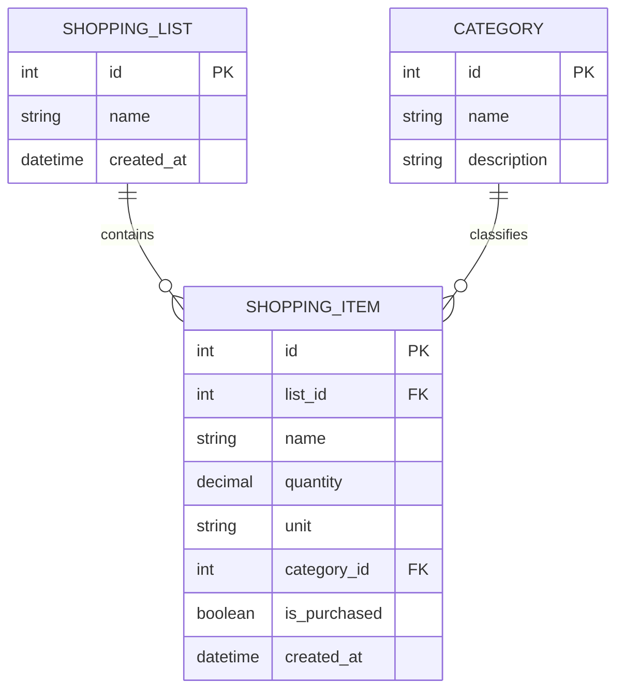
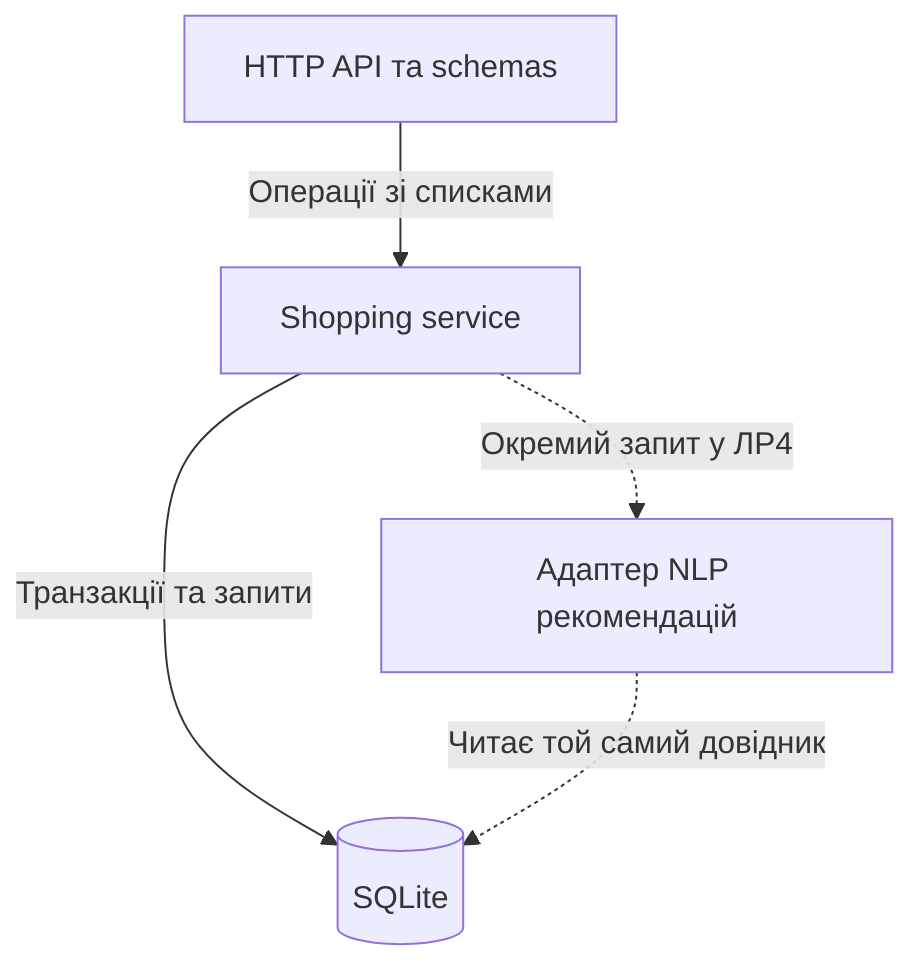

# Архітектура системи списків покупок

**Команда:** Данченко Денис; Пархоменко Олександр. **Версія:** lab01-spec.

Система є невеликим локальним вебсервісом. Архітектура визначає три поточні компоненти та місце майбутнього адаптера категоризації. Поля й правила беруться з [requirements.md](requirements.md), без альтернативного контракту.

## 1 Модель сутностей

Список містить довільну кількість позицій, позиція належить рівно одному списку та категорії. Статистика — обчислюваний результат, окрема таблиця їй не потрібна. Три сутності відповідають обмеженню 3–5 таблиць. Користувач є актором сценаріїв, окрема таблиця акаунтів не вводиться.

## 2 Компоненти та залежності

Три поточні компоненти — API, Shopping service та SQLite. Пунктирний адаптер — майбутній модуль у тому самому застосунку, не окремий обов’язковий мікросервіс. У ЛР1 він лише спроєктований. Звичайні операції Shopping service не викликають адаптер; окремий метод рекомендації доступний у ЛР4. Адаптер не має операцій запису до таблиці позицій.

| Компонент | Відповідальність | Пов’язані вимоги |
| --- | --- | --- |
| HTTP API та schemas | Приймає path/query/body, відхиляє зайві поля та неправильні типи, формує HTTP-відповіді за контрактом | FR-01–FR-08 |
| Shopping service | Перевіряє існування й належність позицій, кінцеві значення PATCH, стан, AND-фільтри та статистичні інваріанти | FR-01–FR-08 |
| SQLite | Зберігає сутності, забезпечує посилальну цілісність, транзакції та узгоджений знімок для статистики | FR-01–FR-08, NFR-02–NFR-04 |
| Майбутній адаптер NLP | Отримує текст і довідник, перевіряє результат моделі, повертає рекомендацію або контрольовану відмову | FR-09, NFR-05 |

## 3 Збереження та технічні обмеження

Таблиці: shopping_lists, shopping_items, categories. На кожному з’єднанні з SQLite до початку транзакції вмикається PRAGMA foreign_keys=ON. FK shopping_items.list_id та category_id посилаються на відповідні PK; видалення категорій і списків через API відсутнє. NOT NULL та CHECK доповнюють валідацію сервісу. Для is_purchased у БД допустимі лише 0 і 1, у JSON — boolean.

Для точного збереження quantity з трьома десятковими знаками проєктується внутрішнє ціле quantity_milli = quantity × 1000, у межах 1–10000000. API продовжує використовувати поле quantity як JSON-число. Для шт/уп quantity_milli кратне 1000. Це технічне представлення одного поля, не нова бізнес-сутність. Під час перетворення застосовується десяткова арифметика без округлення неприпустимого входу.

Індекси: (list_id, created_at, id), (list_id, category_id, is_purchased). Читання загального та категорійного підсумку виконується в одній read-транзакції. Весь PATCH перевіряється і записується в одній write-транзакції; при винятку виконується rollback. Довідник наповнюється за нормативною таблицею requirements.md, розділ 4.3, без повторних дублікатів.

## 4 ADR-01 Локальне збереження у SQLite

**Контекст.** Навчальній системі потрібні три пов’язані таблиці, транзакції, локальний запуск і збереження після перезапуску. Обсяг даних та одночасних записів невеликий.

**Варіанти.** Дані у пам’яті або JSON-файлі; SQLite; PostgreSQL.

**Рішення.** Використати SQLite у файлі database.db; для тестів — окрему тимчасову БД.

**Причина.** SQLite не потребує окремого сервера БД і підтримує SQL-зв’язки та транзакції. Це відповідає масштабу й рекомендованому стеку. JSON потребував би власної реалізації зв’язків і атомарності, а PostgreSQL додає адміністрування окремого сервера.

**Наслідки.** Просте локальне відтворення; потрібні явне ввімкнення FK та коректні транзакції. SQLite має лише одну одночасну write-транзакцію; при зростанні конкурентного запису вибір БД потрібно переглянути. Наявність транзакцій не замінює валідацію полів.

## 5 ADR-02 Окрема рекомендація з підтвердженням користувача

**Контекст.** FR-09 вимагає семантичної категоризації, а вибір категорії залишається за людиною. Основні покупки повинні працювати при недоступному AI.

**Варіанти.** Автоматично записувати категорію під час Create; надавати лише словникову підказку; окремо запитувати NLP-рекомендацію та зберігати категорію через звичайну дію користувача.

**Рішення.** Третій варіант: окремий адаптер з інтерфейсом recommend_category(name, categories), підключений у ЛР4. Конкретна модель й локальний або зовнішній спосіб її запуску визначаються на етапі ЛР4 за доступністю, українською мовою, якістю та часом роботи. Кандидат вибирається на development-наборі.

**Причина.** Межа рекомендації відокремлює затримку моделі від звичайного CRUD та забезпечує людський контроль. Один довідник запобігає появі категорій, яких немає в системі. Ключові слова залишаються baseline для перевірки доцільності NLP.

**Наслідки.** Додатковий майбутній запит рекомендації, перевірка схеми відповіді й тайм-аут. Потрібні повідомлення про неоднозначність або недоступність. Фонова черга, векторна БД і навчання з нуля не потрібні для цієї специфікації. Вищу точність моделі потрібно довести експериментом.

## 6 Майбутня структура реалізації

| Частина | Файли або модулі | Етап |
| --- | --- | --- |
| API та валідація | main.py, schemas.py, routers/lists.py, routers/categories.py | ЛР2 |
| Сервіс | services/shopping.py | ЛР2 |
| Доступ до даних | db.py, models.py, repositories/shopping.py | ЛР2 |
| Тести | tests із сценаріями traceability.csv | ЛР3 |
| Рекомендації | services/recommender.py, adapters/nlp.py | ЛР4 |

Таблиця є планом, а не переліком уже створених файлів застосунку. Поведінку HTTP визначено у [api-contract.md](api-contract.md).

## 7 Технології та методична основа

Стек: Python — серверна логіка; FastAPI — REST API, schemas і документація; SQLite — три таблиці та транзакції; pytest — майбутні тести. Він відповідає рекомендованому стеку методички. Інша технологічна платформа в цьому комплекті не використовується.

Джерела проєктування: надані «ЛР01 Вимоги та проєктування з AI-асистентом», «Методичний гід до виконання ЛР1», структура прикладу VerbaDesk та постановка користувача з дев’ятьма FR.

Технічні джерела, перевірені 19.11.2026:

- [FastAPI Body Updates](https://fastapi.tiangolo.com/tutorial/body-updates/) — часткове оновлення й відокремлення переданих полів.
- [RFC 5789](https://www.rfc-editor.org/rfc/rfc5789.html) — атомарність застосування PATCH.
- [SQLite Foreign Keys](https://www.sqlite.org/foreignkeys.html) — контроль посилань на кожному з’єднанні.
- [SQLite Transactions](https://www.sqlite.org/lang_transaction.html) — COMMIT/ROLLBACK і узгоджене читання.

## 8 Розподіл відповідальності за документ

Данченко Денис: модель сутностей, зв’язки та межа AI-рекомендації. Пархоменко Олександр: схема компонентів, технічне збереження й ADR-01/ADR-02. Підсумок взаємної перевірки записується у lab-01.md.
